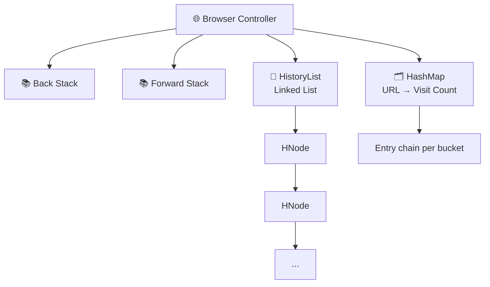

# BROWSER_HISTORY_MANAGER_SYSTEM
<div align="center">

# 🌐 Browser History Manager

### Back • Forward • History • Search — powered by **Stack, Linked List & HashMap**


*A console-based simulation of how a real web browser stores history and navigates between pages, with every data structure coded from scratch.*

</div>

---

## 📑 Table of Contents
- [✨ Features](#-features)
- [🧱 Data Structures Used](#-data-structures-used)
- [🏗️ Architecture](#️-architecture)
- [📂 Project Structure](#-project-structure)
- [▶️ How to Run](#️-how-to-run)
- [🖥️ Menu & Sample Output](#️-menu--sample-output)
- [⚙️ How It Works](#️-how-it-works)
- [🚀 Future Enhancements](#-future-enhancements)
- [👤 Author](#-author)

---

## ✨ Features

| | Feature |
|---|---|
| ⏪⏩ | **Back / Forward** navigation in O(1) using two Stacks |
| 🧹 | Forward history auto-clears when a new URL is opened (like Chrome) |
| 📜 | Full browsing history in a singly **Linked List** (latest first) |
| 🔎 | Instant URL search + visit counting with a **HashMap** (chaining) |
| 🛡️ | Safe handling of empty-stack cases |
| ♻️ | Proper memory cleanup when history is cleared |
| 🧩 | Clean, modular, menu-driven design |

---

## 🧱 Data Structures Used

| Data Structure | Class | Role | Complexity |
|:---|:---|:---|:---:|
| 📚 Stack (Array) | `backStack` | Pages visited earlier | O(1) push/pop |
| 📚 Stack (Array) | `forwardStack` | Pages available for Forward | O(1) push/pop |
| 🔗 Singly Linked List | `HistoryList` | Chronological history, latest first | O(1) insert |
| 🗂️ HashMap (Chaining) | `HashMap` (size 101) | URL → visit count | O(1) avg |

> **Hash function:** `h = (h × 31 + character) % 101`, applied to every character of the URL.

---

## 🏗️ Architecture



---

## 📂 Project Structure

```
Browser-History-Manager/
├── 📄 browser_history.cpp          # C++ implementation
├── 📄 BrowserHistoryManager.java   # Java implementation
├── 🖼️ preview_output.png           # Output screenshot
└── 📘 README.md
```

---

## ▶️ How to Run

<details open>
<summary><b>🔷 C++</b></summary>

```bash
g++ browser_history.cpp -o browser_history
./browser_history          # Windows: .\browser_history
```
</details>

<details open>
<summary><b>☕ Java</b></summary>

```bash
javac BrowserHistoryManager.java
java BrowserHistoryManager
```
> ⚠️ The file name must stay `BrowserHistoryManager.java` (it must match the public class name).
</details>

---

## 🖥️ Menu & Sample Output

```
===== BROWSER HISTORY MANAGER =====
1. Visit URL        5. View History
2. Back             6. Search URL
3. Forward          7. Clear History
4. Show Current Page  0. Exit
```


<details>
<summary><b>📋 Text version of the run</b></summary>

```
Opened: google.com
Opened: github.com
Opened: youtube.com
Back to: github.com
Back to: google.com
Current Page: google.com
Forward to: github.com
Opened: google.com
---- Browsing History (Latest First) ----
  #4  google.com
  #3  youtube.com
  #2  github.com
  #1  google.com
google.com found. Visited 2 time(s).
facebook.com not found in history.
Exiting...
```
</details>

> 💡 Enter URLs without spaces, e.g. `google.com`.

---

## ⚙️ How It Works

| Step | Action | What happens |
|:---:|---|---|
| 1️⃣ | **Visit URL** | Push current → Back Stack, clear Forward Stack, insert at head of list, update HashMap count |
| 2️⃣ | **Back** | Push current → Forward Stack, pop Back Stack |
| 3️⃣ | **Forward** | Push current → Back Stack, pop Forward Stack |
| 4️⃣ | **View History** | Traverse linked list from head to tail |
| 5️⃣ | **Search URL** | Probe one hash bucket, return visit count |
| 6️⃣ | **Clear History** | Delete all nodes/entries, reset both stacks |

---

## 🚀 Future Enhancements

- [ ] 💾 File handling / SQLite so history persists after restart
- [ ] 🧮 History size limit using a Queue or LRU Cache
- [ ] 🗑️ Delete single entries & bookmarks (Doubly Linked List)
- [ ] 🗂️ Multiple tabs with separate Back/Forward stacks
- [ ] 🏆 Most-visited ranking (Max Heap) & URL auto-suggest (Trie)
- [ ] 🖼️ GUI or browser extension

---

## 🛠️ Requirements

- **C++:** GCC / G++ with C++11 or above
- **Java:** JDK 8 or above
- Any editor: VS Code, Code::Blocks, IntelliJ

---

## 👤 Author

<div align="center">

**Eklavya Pandey**
🎓 ERP ID: `RU-25-10495` &nbsp;|&nbsp; Roll No: `16`
B.Tech CSE (with Core in association with Google)
🏫 School of Computer Science and Engineering, Rungta International Skills University, Bhilai, CG
📘 Data Structures and Algorithms Project • Session 2026-27

⭐ *If you found this project helpful, give it a star!* ⭐

</div>
